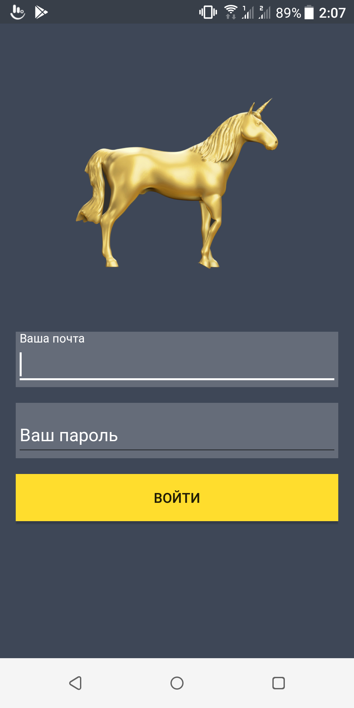
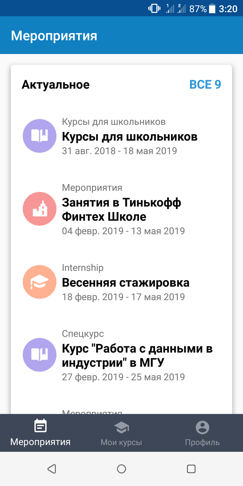
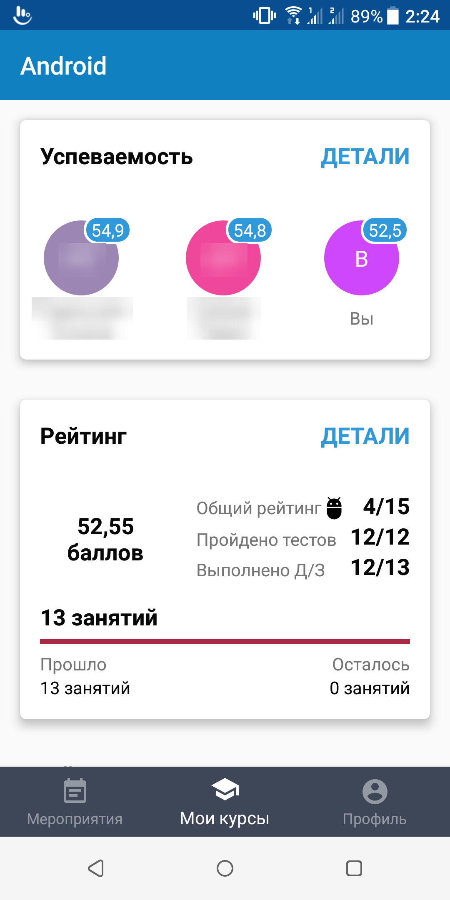
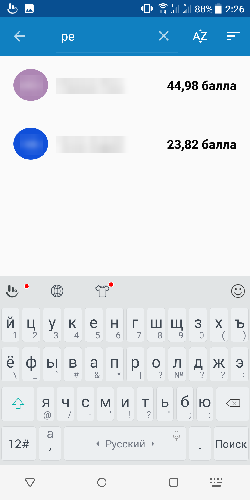
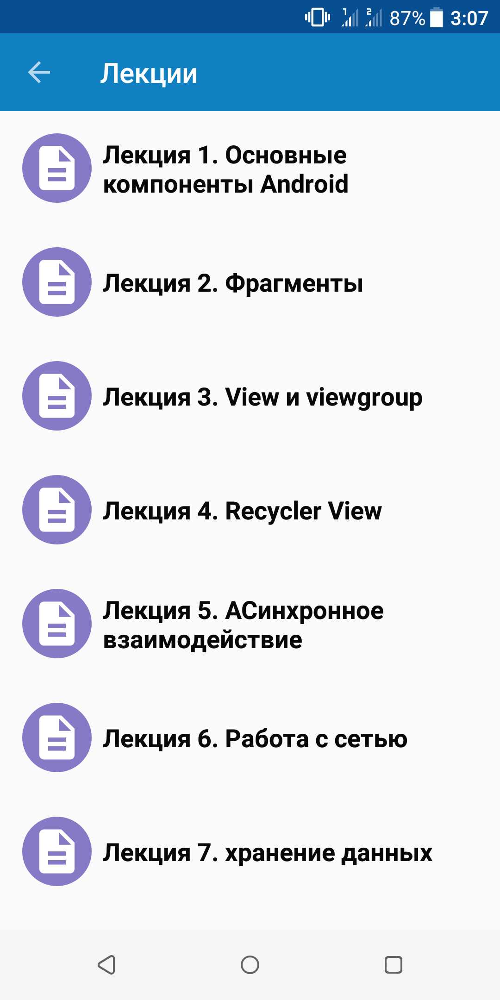
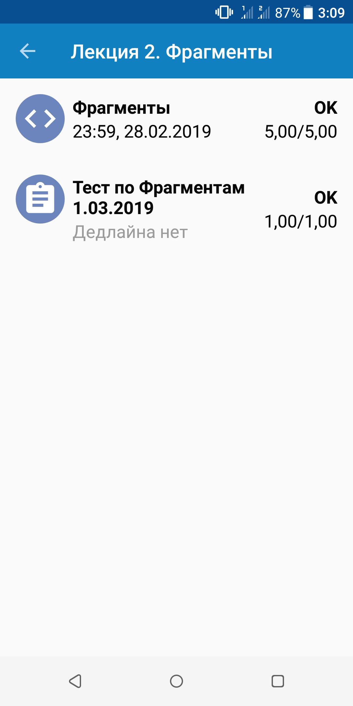
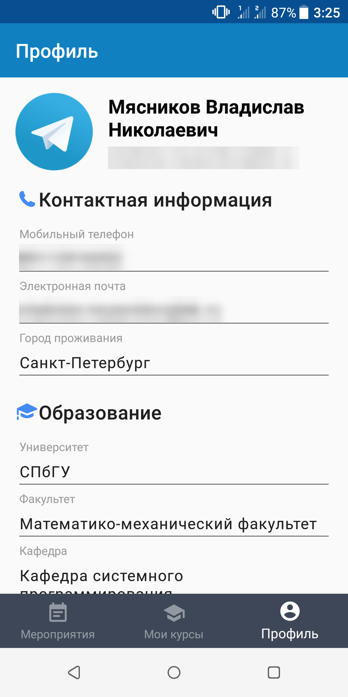

# Tinkoff Fintech Student App

An Android client for the Tinkoff Fintech school portal. Students use it to track events, course progress, homework and their ranking among other students.

Built in Kotlin with Clean Architecture, MVVM, Dagger 2 and RxJava. It was built against the real portal API and stays usable offline thanks to a local cache.

> **Note:** this project was built in 2019 during the Tinkoff Fintech school. The portal API it relies on (`fintech.tinkoff.ru`) is no longer available, so the app can't sign in or load fresh data anymore. The screenshots below were taken while the portal was live.

## Highlights

- **Real API integration**: cookie-based authorization against the production `fintech.tinkoff.ru` API, with session persistence and a graceful return to sign-in when the session expires.
- **Offline-first data layer**: every screen shows cached data from Room instantly, then refreshes from the network, with a cache lifetime that prevents redundant requests.
- **Clean Architecture**: separate `data`, `domain` and `presentation` layers, repository interfaces in the domain layer, and mappers between network, database and domain models.
- **Reactive UI**: RxJava streams from repositories through ViewModels to the views, with loading state and typed errors handled in one place.
- **Polished UI details**: DiffUtil-powered lists, custom item animations and decorations, custom Views (such as initials avatars), and pull-to-refresh on every screen.

## Features

### Sign in
- Sign in with a Tinkoff Fintech portal account.
- Client-side validation of the e-mail and password.
- The session is remembered until it expires, so returning users go straight to the app.
- Logging out wipes the session and all cached data.

### Events
- Current and past school events: courses, internships and school activities, each with a category icon and dates.
- A short preview for each group, with an "All" button that opens the full list.

### My courses
- **Academic performance**: the top students of the course next to the current user's own score, plus a full student list with live search by name and sorting by name or points.
- **Rating**: total points, place in the overall ranking, passed tests, completed homework, and a progress bar of past and remaining classes.
- **Lectures**: every lecture of the course. Each lecture opens its homework and tests, with deadline, status and score (for example `5.00/5.00`).
- **Completed courses**.

### Profile
- Avatar, contact details, education and personal information.

## Screenshots

| Sign in | Events | My courses | Student search |
| :---: | :---: | :---: | :---: |
|  |  |  |  |

| Lectures | Lecture tasks | Profile |
| :---: | :---: | :---: |
|  |  |  |

## Tech stack

| Area | Technologies |
| --- | --- |
| Language | Kotlin |
| Architecture | Clean Architecture, MVVM, Repository pattern |
| Dependency injection | Dagger 2 (custom Activity and Fragment scopes) |
| Async | RxJava 2, RxAndroid |
| Networking | Retrofit 2, OkHttp 3, Gson |
| Persistence | Room, SharedPreferences |
| UI | AndroidX, Material Components, ViewModel, RecyclerView + DiffUtil, Glide, custom Views |
| Min / target SDK | 21 / 28 |

## Architecture

```
app/src/main/java/com/vladislavmyasnikov/courseproject/
├── presentation/   # Activities, fragments, ViewModels, adapters, custom Views
├── domain/         # Domain models and repository interfaces
├── data/           # Repository implementations, Retrofit API, Room DAOs and entities, mappers
└── di/             # Dagger 2 components, modules and scopes
```

Data flows one way: **API / Room → Repository → ViewModel → View**. Repositories return RxJava streams that emit cached data first and fresh network data second. ViewModels expose the data, the loading state and the errors as separate streams for the UI.

## Build

```bash
./gradlew assembleDebug
```

Or open the project in Android Studio and run the `app` configuration. The app's UI is in Russian.
